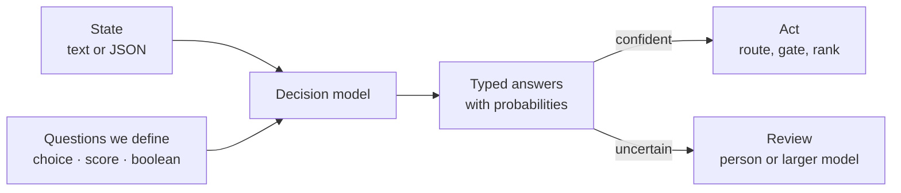
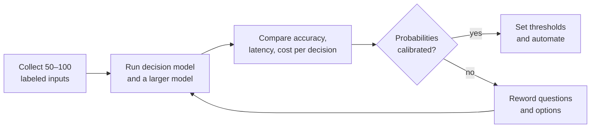

# Decision Models

> **Ask a question, get a typed answer.** A decision model doesn't write a reply.
> It returns a choice, a score, or a probability that our application can act on.

Many steps in an AI application are small judgments: which team should handle
this request, how urgent is it, is the customer asking for a refund? A decision
model, called through a decision API, is built for exactly those steps.



## How does a decision API work?

We send **state** — the evidence the model should consider — and one or more
named **questions**. We get back one typed answer per question.

| Question type | We ask | We get back |
|---|---|---|
| Choice | Which of these options fits? | The selected option, with a probability for every option |
| Score | Where does this fall on an ordered scale? | A position on the scale, which can fall between levels |
| Boolean | Is this statement true? | The probability of yes, from 0 to 1 |

Providers name the boolean type differently — Boolean, `noul`, or predicate. A
boolean near zero means the model favors *no*; it doesn't mean the model is unsure.

Here's a request for [Microsoft-Decision-1](https://ai.azure.com/catalog/models/Microsoft-Decision-1)
on Microsoft Foundry. Two questions share the same state in one call:

```json
{
  "model": "<our deployment name>",
  "state": "Checkout is down again. This is my third request.",
  "questions": {
    "team": {
      "type": "choice",
      "instructions": "Which team should handle this request?",
      "criteria": {
        "billing": "Charges, invoices, and refunds",
        "engineering": "Bugs, errors, and outages",
        "support": "How-to and account questions"
      }
    },
    "severity": {
      "type": "score",
      "instructions": "How severe is this issue?",
      "criteria": ["Cosmetic", "Minor", "Major", "Critical"]
    }
  }
}
```

If a later question needs an earlier answer, our code passes that answer into a
second call.

## How do we make the answers trustworthy?

- **Leave a way out.** Add a "review" or "cannot tell" option so a forced choice
  doesn't hide missing information.
- **One label, one question.** If several labels can apply, ask separate boolean
  questions instead of one choice.
- **Keep exact checks in code.** If a record already has a trusted `refunded`
  field, read it. Use the model for judgments that need interpretation, like
  whether a customer is *asking* for a refund.
- **Word it neutrally.** Rephrasing a question or reordering options can shift
  scores — randomize option order and test whether results change.
- **Set thresholds from real costs.** Decide how confident the model must be to
  act alone, based on the cost of a false positive versus a false negative.

## How is it different from structured outputs?

A chat model can already return a category as valid JSON, and
[structured outputs](https://learn.microsoft.com/en-us/azure/foundry/openai/how-to/structured-outputs)
constrain that JSON to a schema. A decision model differs in its interface and
its output: it scores the allowed answers directly and returns probabilities, so
we don't parse prose or ask a model to guess its own confidence.

They combine well. A decision model gates or routes a request, and only the
requests that need prose reach a [chat](chat-completion.md) or
[reasoning](reasoning-models.md) model — the same
[right-sizing](optimization.md#right-sizing) idea a
[model router](model-router.md) applies to model choice.

## Who offers one today?

The decision API pattern is new, and several providers shipped it within weeks
of each other:

| Model or service | Access | What stands out |
|---|---|---|
| [Microsoft-Decision-1](https://ai.azure.com/catalog/models/Microsoft-Decision-1) | Microsoft Foundry, public preview | Built on Qwen3.5-9B; choice, score, and yes/no questions over text or JSON |
| OpenAI Decisions API | Public beta | Predicate, choice, and score over text or images; announced at DevDay on 2026-09-29 |
| [Jev](https://jevmodel.org/) from TypeSafe AI | Hosted API | Choice, score, and `noul` questions; the request format others now follow |
| Perplexity Decisions API | Hosted API and open weights | Text and images; weights under Apache 2.0 |
| Liquid d1, Laya, Typical | Hosted and open weights | Open options; Laya uses an encoder with a decision head |

An identical request doesn't guarantee identical behavior: some adapters return
true probability distributions, while others prompt a model for a yes/no estimate.

## What is Microsoft-Decision-1 good at?

- **Gates and filters** — does this reply promise a refund, or this tool call touch production data?
- **Classification and routing** — send a ticket, alert, or document to one option from a known set.
- **Ranking and prioritization** — order incidents, leads, or review queues on our own scale.
- **Evaluation and grading** — score model output against an ordered rubric.
- **Model, tool, or agent selection** — pick what handles each request.

Xbox Research used it to sort more than 10,000 open-ended feedback comments into
researcher-defined themes, and reported quality competitive with GPT-5 at 80 to
100 times the speed. It deploys as `GlobalStandard`, or `DataZoneStandard` in
selected regions to keep inference in the data zone closest to our app.

## How do we test one on our own data?

A decision model earns its place on our workload, not on a benchmark:



1. Collect 50–100 real inputs with the answer we expect, including a few ambiguous ones.
2. Run them through the decision model and a larger model.
3. Compare accuracy (especially on the ambiguous cases), latency at our expected traffic, and cost per completed decision.
4. Before automating on probabilities, check calibration: a probability of 0.8 should be right about 80 percent of the time.

## When should we *not* use one?

- We need a written explanation, a plan, or code.
- The decision has no agreed options or right answer yet — define those first.
- The volume is tiny, so a larger model and a good prompt are simpler.
- It would be the sole decision-maker on consequential choices about people
  (credit, employment, housing, healthcare, legal). Use it for decision support
  with meaningful human review, and tell people when AI contributes to a decision.

## Learn more

1. [Introducing Microsoft-Decision-1 in Microsoft Foundry](https://techcommunity.microsoft.com/blog/azure-ai-foundry-blog/introducing-microsoft-decision-1-in-microsoft-foundry-for-decision-and-classific/4562742)
2. [Deploy and use Microsoft-Decision-1 in Microsoft Foundry](https://learn.microsoft.com/en-us/azure/foundry/foundry-models/how-to/use-foundry-models-microsoft-decision)
3. [What are decision models? (Vercel)](https://vercel.com/i/what-are-decision-models)
