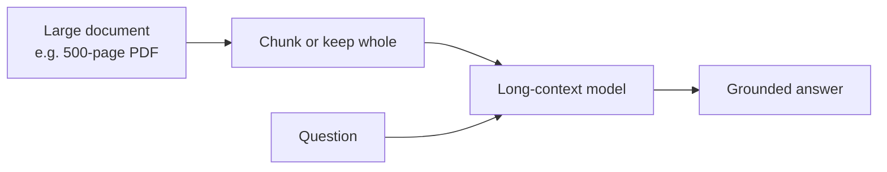

# Long-Context Models

> **Fit the whole thing in the prompt.** Long-context models accept
> hundreds of thousands (sometimes millions) of tokens — enough for
> entire codebases, contract packages, or long transcripts.

## When to reach for it

- One-off analysis of a huge document where RAG feels heavy-handed.
- Whole-repo code understanding.
- Multi-turn agent sessions with long tool traces.

## When *not* to

- Recurring queries — RAG + smaller models is cheaper long-term.
- Latency-sensitive UX — bigger contexts mean slower responses.

## Key terms

### Context Window

*"How much can the model actually take in on a single call?"*

A context window is the maximum number of tokens a model can consider at once —
our prompt, the conversation history, retrieved documents, and the model's own
reply all count against it. When we exceed it, older content is dropped or must
be summarized, which can quietly change the answer we get back. Because
everything in the window is billed as input, the context window is where
[tokenomics](optimization.md#tokenomics) meets a hard limit — a practical reason
to trim context and [right-size](optimization.md#right-sizing) each request.

## Learn more

1. [Foundry Models overview — context windows](https://learn.microsoft.com/en-us/azure/foundry/concepts/foundry-models-overview)
2. [GPT-5 vs GPT-4.1 model choice guide](https://learn.microsoft.com/en-us/azure/foundry/foundry-models/how-to/model-choice-guide)
3. [Model leaderboards — compare context window sizes](https://learn.microsoft.com/en-us/azure/foundry/concepts/model-benchmarks)
