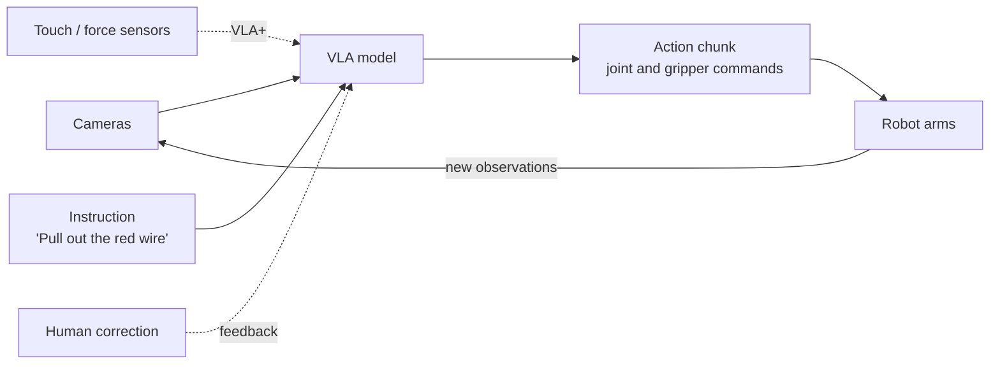

# Robotics (Vision-Language-Action)

> **From words to motion.** A vision-language-action (VLA) model takes what a
> robot sees and an instruction in plain language, and outputs the control
> signals that move the robot.

*"How does a language model end up flipping a switch?"*

A VLA model is a vision-language model extended with an **action** output.
It reads camera frames and an instruction, reasons about the scene, and
returns short sequences of motor commands, then repeats as the world changes.
That loop is what lets robots leave tightly scripted assembly lines and work
in less structured places alongside people. This area is often called
**physical AI** — agentic AI meeting physical systems.

Microsoft Research's **Rho-alpha (ρα)** is an example: derived from the Phi
family of vision-language models, it translates natural-language commands into
control signals for two-armed (bimanual) manipulation. It's a *VLA+* model
because it also uses **tactile sensing**, and it's designed to keep improving
from human corrections during operation. It's in a Research Early Access
Program now, with availability through Microsoft Foundry planned for later.
The Foundry catalog already includes related physical-AI models, such as
NVIDIA's Cosmos-Reason1 for task-completion verification, action affordance,
and next-action prediction.

## When to reach for it

- Manipulation in changing environments — picking, placing, plugging, opening, packing.
- Instructing a robot in natural language instead of hand-coding each motion.
- Mobile manipulation that combines mapping, navigation, and grasping ("check the kitchen for rubbish and put it in the trash").
- Research and prototyping on dual-arm rigs or humanoids, with simulation to fill data gaps.

## When *not* to

- Fixed, repetitive motions on a production line — classic motion planning is cheaper and fully predictable.
- Safety-critical actions without a human in the loop or hard safety limits.
- We only need to *understand* an image or video — a [multimodal](multimodal-models.md) model is enough.

## Key terms

### Physical AI

*"What changes when the AI's output is a movement, not text?"*

Physical AI is about systems that perceive, reason, and act in the real
world through robots. Mistakes have physical consequences, the environment
keeps changing, and every robot body (embodiment) is different — so these
systems lean on simulation, feedback from people, and tight perception-action
loops.

### Inference Offloading

*"Does the model have to run on the robot?"*

Inference offloading runs the model on an edge or cloud GPU instead of a GPU
inside the robot. Microsoft Research measured that onboard GPUs can cut VLA
accuracy and drain batteries, while offloading improved task success and
extended operating time — trading that against network latency and bandwidth.
The open-source Physical AI Toolchain adds Kubernetes-based tooling for it.

### Sim-to-Real

*"Where does the training data come from?"*

Sim-to-real means training on simulated trajectories and transferring the
skill to a physical robot. Robot demonstration data is scarce — especially
with touch — so models like Rho-alpha co-train on physical demonstrations,
reinforcement-learning trajectories from simulators such as NVIDIA Isaac Sim,
and web-scale visual question-answering data.

## Learn more

1. [Advancing AI for the physical world — Rho-alpha](https://www.microsoft.com/en-us/research/story/advancing-ai-for-the-physical-world/)
2. [Offloaded inference for real-world physical AI robotics](https://www.microsoft.com/en-us/research/blog/offloaded-inference-for-real-world-physical-ai-robotics/)
3. [Deploy Foundry Models to managed compute — includes Cosmos-Reason1](https://learn.microsoft.com/en-us/azure/foundry-classic/how-to/deploy-models-managed-pay-go)
