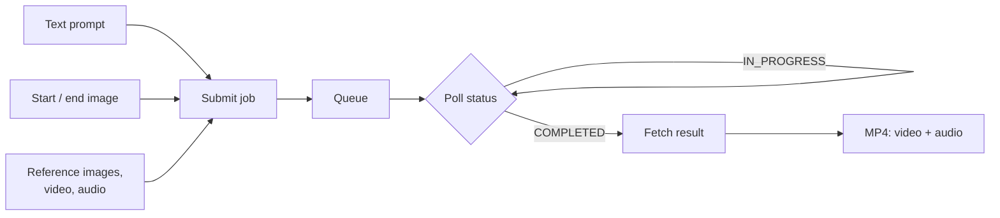

# Video Generation Models

> **Words and pictures in, moving pictures out.** A video generation model turns a
> prompt, and optionally a start image, an end image, or reference clips, into a
> short video clip, often with a matching soundtrack.

A video generation model is an image generation model that also has to get
**time** right. Every frame must look good, and the frames must agree with each
other: the same product, the same face, the same light, moving the way real
things move. That is why video costs more, takes longer, and needs a different
kind of prompt than a single image.

 

## When should we reach for video generation?

- **Marketing and social:** product teasers, seasonal variants, and vertical
  clips for every channel from one brief.
- **Product pages:** short loops that show a product in use.
- **Concepts and storyboards:** test a creative idea before booking a shoot.
- **Animating existing assets:** bring a product photo, poster, or illustration
  to life.
- **Localization and variation:** the same scene in other formats, seasons, or
  settings without reshooting.

## When should we *not*?

- **Factual or instructional truth.** A generated how-to clip can show steps that
  are wrong or unsafe. Treat it as illustration and have an expert review it.
- **Real people.** Don't generate the likeness of a real person without consent,
  and check the provider's policies first.
- **Evidence or documentation.** Generated footage must never stand in for a
  record of what happened.
- **Long-form video.** Today's models make clips of seconds, not minutes. Longer
  pieces mean stitching many clips and fixing the joins.
- **Exact text or exact product geometry.** Labels, logos, and small parts can
  drift from frame to frame. Check every clip before it ships.

 

## How does a video request work?

Video takes tens of seconds to minutes to render, so the API is **asynchronous**:

1. **Submit** a job with the prompt and settings. The service returns a `request_id`.
2. **Poll** the status endpoint until it reports `COMPLETED` (or an error).
3. **Fetch** the result. It holds a URL to the MP4, which we download.

Plan for this in code (timeouts, retries, progress) and in the product (a
"we're rendering your video" state, not a spinner on a chat reply).

 

## Key terms

### Text-to-video

*"What do we get from a prompt alone?"*

Text-to-video generates a clip from words only. The model invents everything:
the setting, the product's look, the camera. It's the fastest way to explore an
idea and the least controllable.

### Image-to-video

*"How do we keep our real product in the shot?"*

Image-to-video starts from an image we supply and animates it. The first frame
is (close to) our image, so composition, colors, and the product's look start
where we want them. Most models also accept an optional **end image**.

### First and last frame (keyframes)

*"Can we control where the clip starts and where it ends?"*

First and last frame control pins the opening and closing frames, and the model
invents the motion between them: a packed tent bag at the start, a pitched tent
at the end. Some models also accept a **middle frame** at a set time.

### Reference-to-video

*"How do we put three specific products and one person in the same scene?"*

Reference-to-video takes several reference images (and sometimes video or audio
clips) that the clip should stay faithful to, without fixing any single frame.
The prompt names them by position, for example "the hiker from Image 1 opens the
backpack from Image 2".

### Elements (subject locking)

*"How do we keep the same character across shots?"*

An element is a subject defined once, from a front view plus extra angles or a
short video, and reused across shots. Some models also bind a **voice** to the
element so its dialogue sounds the same every time.

### Multi-shot generation

*"Can one request give us a cut, not just one continuous take?"*

Multi-shot generation produces several connected shots in one clip, keeping the
character, setting, light, and style consistent across the cuts. We either list
the shots (each with its own prompt and length) or let the model decide where to
cut.

### Native audio

*"Do we need a separate sound pass?"*

Native audio means the model generates the soundtrack together with the picture:
ambience, effects, music, and sometimes lip-synced dialogue. It's usually on by
default. Turn it off when the clip will get its own soundtrack. Some models can
also **pin** a soundtrack we supply.

### Duration, resolution, frame rate, aspect ratio

*"What shape of clip can we ask for?"*

These four settings define the clip, and they limit each other:

- **Duration:** seconds of output. Models offer fixed steps or a range, sometimes
  `auto`. The delivered clip can run slightly longer than requested.
- **Resolution:** from 480p drafts to 1080p and, on some models, 4K. Some models
  produce 1080p by **upscaling** a lower native resolution.
- **Frame rate (fps):** 24 looks cinematic, 50 looks smooth for fast motion. Higher
  rates often cap the maximum duration.
- **Aspect ratio:** 16:9 for web, 9:16 for phones, 1:1 for feeds, 21:9 for banners.

### Temporal consistency

*"Why does the logo melt halfway through?"*

Temporal consistency is how well things stay the same over time: shapes, text,
faces, and colors. It's the main quality difference between video models, and
the first thing to check in any clip.

### Camera motion

*"Can we direct the camera?"*

Camera motion describes how the virtual camera moves: dolly in or out, track
left or right, jib up or down, orbit, rack focus. Some models take it as a
setting; all of them respond to it in the prompt.

### Prompt expansion

*"Why doesn't the model do exactly what we wrote?"*

Prompt expansion rewrites a short prompt into a longer, more detailed one before
generation. It helps with terse prompts and hurts with carefully written ones.
When a model returns the expanded prompt, read it: it shows what the model was
really asked to make.

### Seed

*"How do we compare two settings fairly?"*

A seed fixes the random starting point. The same seed, prompt, and settings give a
similar result, so a change in output comes from the setting we changed, not from
luck.

### Guidance (CFG) and negative prompt

*"How strictly does the model follow the prompt?"*

Guidance scale (CFG) sets how closely the model sticks to the prompt: higher is
more literal, lower is more natural. A negative prompt lists what to avoid, such
as "blur, distorted text". Use both sparingly.

 

## How do cost, latency, and quality trade off?

Every setting that adds pixels, frames, or seconds adds cost and render time.

| Setting | Quality | Latency | Cost |
| --- | --- | --- | --- |
| Longer duration | More story per clip; more chances to drift | Up | Up (often billed per second) |
| Higher resolution | Sharper detail and text | Up | Often up |
| Higher frame rate | Smoother fast motion | Up | Often up; may cap duration |
| Native audio on | Saves a sound pass | Slightly up | May be up |
| More references | Better subject fidelity | Up | May be up |
| Prompt expansion | Richer scenes from short prompts | Slightly up | Usually none |
| Fast or Turbo tier | Somewhat lower fidelity | Much lower | Lower |

A pattern that works: **draft cheap, finish expensive.** Explore prompts at
480p or 720p, short durations, on a Fast or Turbo model with a fixed seed. Render
only the winner at full resolution on the Pro or Max model.

Rate limits matter more than for text or images. A low quota tier can allow only
a couple of requests per minute, so batch work needs a queue, not a loop.

 

## How do we prompt a video model?

Write a **shot**, not a sentence. A reliable order:

1. **Subject:** who or what, with the details that must stay fixed.
2. **Action:** one clear action per shot, with a start and an end.
3. **Setting:** place, time of day, weather.
4. **Camera:** shot size, angle, and movement.
5. **Light and style:** golden hour, overcast, claymation, film grain.
6. **Audio:** ambience, effects, dialogue (in quotes), or "no music".

For example:

> *Medium shot of the orange-and-green TrailMaster X4 tent on a granite ledge at
> sunrise. Rain starts; drops bead and run off the rainfly while the tent stays
> taut. Slow dolly in toward the door. Soft golden light, light mist over the lake
> below. Audio: steady rain on fabric, distant birds, no music.*

More tips:

- **Name references by position** ("Image 1", "Video 1") exactly as the API documents.
- **Quote on-screen text** and keep it short: a headline and a price, not a paragraph.
- **One change at a time** with a fixed seed, so we learn what each change does.
- **Describe physics** we care about: fabric moving in wind, steam rising, water beading.
- **Avoid contradictions** between the prompt and the input image, such as a prompt
  for night with a midday start frame.
- **Check the expanded prompt** when the model offers one.

 

## Where does video generation pay off?

| Domain | Typical use |
| --- | --- |
| Retail and e-commerce | Product-page loops, launch teasers, seasonal variants |
| Marketing and advertising | Social cut-downs, A/B creative, localized versions |
| Media and entertainment | Previsualization, storyboards, concept trailers |
| Travel and real estate | Destination and property mood clips |
| Training and education | Illustrative scenes (reviewed by an expert) |
| Internal communications | Event openers, explainer intros |

 

## What sets one video model apart from another?

When we compare models, these differences decide the pick:

- **Input modes:** text, image, first and last frame, middle frame, references.
- **Subject control:** element locking, multi-character scenes, voice binding.
- **Shot control:** single take or multi-shot, and per-shot timing.
- **Audio:** none, generated, or pinned to our own clip; which languages it speaks.
- **Camera control:** prompt only, or a dedicated setting.
- **Output range:** durations, resolutions, frame rates, and aspect ratios.
- **Speed tier:** a quality model and a fast sibling of the same family.
- **Hosting and data:** who runs the model, which deployment types and regions
  are offered, and where the data goes.

The fal video family on Microsoft Foundry (preview) shows how wide the spread is:

| Model | Stands out for | Durations | Resolutions | Deployment |
| --- | --- | --- | --- | --- |
| Kling V3 Pro | Multi-shot storyboards, element locking with voice, cinematic camera moves | 3–15 s | Not specified | US Data Zone |
| LTX 2.5 Pro | Detail in complex scenes, legible text, camera-motion setting | 6–10 s | 720p, 1080p | Global Standard |
| LTX 2.5 Fast | Speed, up to 20 s and 4K | 6–20 s | 720p–2160p | Global Standard |
| MiniMax H3 Max | Reference-to-video (images, video, audio), first, middle, and last frames | 1–15 s | 480P–1080P | Global Standard |
| MiniMax H3 Max Turbo | The H3 Max text and image modes, faster | 1–15 s | 480P–1080P | Global Standard |

fal models are hosted by fal, outside Microsoft. Data leaves Microsoft, and
Microsoft's product terms and data-protection agreements don't apply. Check this
with the customer before any production use.

 

## Try it

- [Kling V3 Pro](../4-models/fal-kling-v3-pro/)
- [LTX 2.5 Pro](../4-models/fal-ltx-2.5-pro/)
- [LTX 2.5 Fast](../4-models/fal-ltx-2.5-fast/)
- [MiniMax H3 Max](../4-models/fal-minimax-h3-max/)
- [MiniMax H3 Max Turbo](../4-models/fal-minimax-h3-max-turbo/)

## Learn more

1. [Fal models on Microsoft Foundry (preview)](https://learn.microsoft.com/azure/foundry/how-to/fal-ai-models/enable-fal-models)
2. [Deployment types in Microsoft Foundry](https://learn.microsoft.com/azure/foundry/foundry-models/concepts/deployment-types)
3. [Risk and safety evaluations](https://learn.microsoft.com/azure/foundry/concepts/safety-evaluations-transparency-note)
