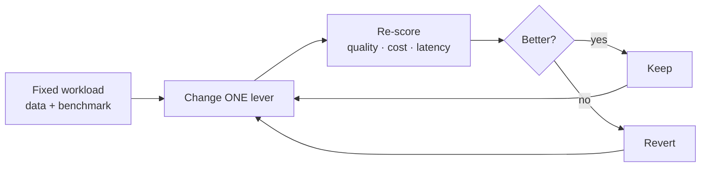

# Model & Agent Optimization

> **Spend less without losing quality.** Optimization is how we move an
> application toward its cost, quality, and latency goals — one measured
> change at a time.

## When to reach for it

- A pilot works, and we now need it to be affordable at production volume.
- Cost or latency regressed after a model, prompt, or traffic change.
- We are choosing between several models for the same task.

## When *not* to

- Before the workload has a benchmark — without a scorecard we can't tell
  whether a change helped.

## Key terms

### Agent Optimization

*"My agent works in the demo — how do I make it worth running in production?"*

Agent Optimization is about treating an AI agent as something we continuously
tune rather than ship once. We match each request to the
[right-sized](#right-sizing) model and settings, improve the agent's workflow as
real usage reveals what works, and keep spend bounded and attributable. The
model-layer moves are [model optimization](#model-optimization); our practical
starting point is a scorecard — cost, latency, and quality — that tells us
whether each change is actually an improvement.

### Hill Climbing

*"Do I improve this with one big rewrite, or lots of small steps?"*

Hill Climbing is an iterative strategy that starts from a working solution and
repeatedly makes small changes, keeping each one only when it improves a
measured objective. Progress comes from many evidence-backed steps rather than
one large redesign. We compare models, prompts, and routing settings this way to
find a better balance of quality, cost, and latency.

### Model Optimization

*"My model costs just spiked — what do I actually change?"*

Model Optimization is a continuous loop that moves an application toward its
cost, quality, and latency goals by pulling on
[optimization levers](#optimization-lever) — model selection, prompt
optimization, context engineering, evaluation, fine-tuning, quantization, and
distillation. We spot a regression, diagnose the driver, change one lever, and
confirm the result against an evaluation dataset that reflects our real
workload.

### Optimization Lever

*"What can I actually turn to move cost, quality, or latency?"*

An optimization lever is one concrete control — model selection and
[right-sizing](#right-sizing), prompt optimization, context engineering,
caching, deployment and pricing modes, fine-tuning, quantization, or
distillation. No single lever wins on its own, so we try them in order and
measure after each one.

### Right-Sizing

*"Do I really need the biggest model for every request?"*

Right-Sizing is about matching each request to the smallest, cheapest model and
settings that still meet its quality bar, so simple work never pays
frontier-model prices. A [model router](model-router.md) applies it
automatically per request; we can also right-size by hand through model
selection, deployment and pricing modes, and shorter prompts.

### Tokenomics

*"Why does my bill keep growing even when users ask simple questions?"*

Tokenomics is about the economics of tokens — the unit a model reads and writes,
and therefore the unit we pay in. Because models are stateless, the full context
is resent on every call (bounded by the
[context window](long-context.md#context-window)), so cost can climb even for a
short follow-up, and an agent that makes several calls per request multiplies
the effect.

## Try it

- [Model Router — August 2026](../capsules/model-router/) — optimize
  instructions, then route each request, on the
  [Contoso Travel dataset](../datasets/contoso-travel/)

## Learn more

1. [Optimize model cost and performance in Microsoft Foundry](https://learn.microsoft.com/en-us/azure/foundry/control-plane/how-to-optimize-cost-performance)
2. [Model router for Microsoft Foundry](https://learn.microsoft.com/en-us/azure/foundry/openai/concepts/model-router)
3. [The Economics of Agent Optimization](https://azure.microsoft.com/en-us/blog/the-economics-of-agent-optimization-from-pilots-to-measurable-returns/)
